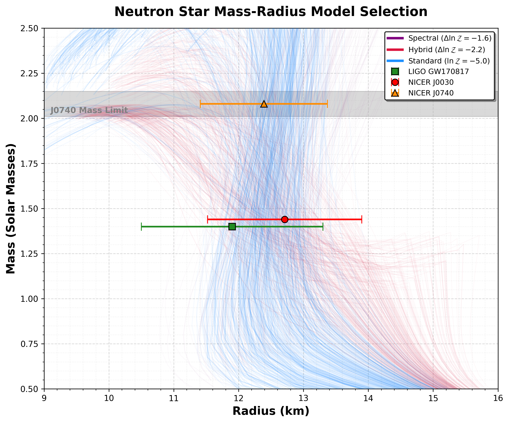

# JAX-Accelerated Bayesian Model Selection for Neutron Star EoS

A pipeline that compares three parameterizations of the neutron-star equation of state (EoS) using nested sampling. It uses **JAX** (vectorized TOV integration) and **dynesty** (Bayesian evidence), with astrophysical radius constraints from GW170817 and NICER.

## Bayesian Model Selection Results

Three EoS parameterizations are compared: a piecewise polytrope, a hybrid hadron-quark model with a constant speed of sound (CSS), and Lindblom's spectral expansion. The likelihood is an approximation built from one-dimensional radius measurements; see [Likelihood](#likelihood) below.

### Model comparison

Results with the corrected energy density and physical cuts (causality, monotonic pressure, stable-branch radii; see [Corrections](#corrections)). Nested sampling used `nlive=300`, `dlogz=0.5`. Medians and 90% intervals are over the posterior.

| Model | $\ln \mathcal{Z}$ | $\ln \mathcal{B}$ vs CSS | $\mathcal{B}$ vs CSS | $M_{max}$ [$M_\odot$] | $R_{1.4}$ [km] |
| :--- | :--- | :--- | :--- | :--- | :--- |
| Hybrid (CSS) | $-7.82 \pm 0.21$ | 0 | 1 | 2.31 [2.12, 2.59] | 12.72 [12.05, 13.52] |
| Piecewise polytrope | $-8.64 \pm 0.23$ | $-0.82$ | 0.44 | 2.24 [2.11, 2.37] | 12.68 [12.03, 13.28] |
| Spectral | $-10.78 \pm 0.27$ | $-2.96$ | 0.05 | 2.30 [2.08, 2.66] | 12.76 [12.14, 13.41] |

The $\pm$ values are `dynesty`'s statistical error on $\ln\mathcal{Z}$ from a single run. They do not include prior or likelihood systematics.

### Interpretation

* All three models agree on the neutron-star properties: $R_{1.4} \approx 12.7$ km and $M_{max} \approx 2.2$-$2.3\,M_\odot$. The data constrain these quantities, not the choice of parameterization.
* The CSS and polytrope evidences differ by $\ln\mathcal{B} = 0.8$, which is not a meaningful preference. The spectral model is lower by about 3 against CSS.
* Most of the evidence differences come from how much of each model's prior is physical. The causality and monotonic-pressure cuts remove prior volume without renormalizing it, so a model whose prior is mostly acausal (as for the spectral and polytrope priors here) is penalized for that. The CSS prior keeps the quark phase causal by construction. With different prior ranges the ordering could change, so these numbers should not be read as evidence for or against a phase transition.
* The likelihood itself is an approximation (see below).



## Likelihood

The likelihood is a product of one-dimensional kernel density estimates (KDEs) of **neutron-star radius at a fixed mass**:

* **$R_{1.4}$ from GW170817:** radius samples from the LIGO/Virgo EoS-insensitive analysis (Abbott et al. 2018), restricted to $1.35 < m_1 < 1.45\,M_\odot$. These radii were derived from the measured tidal deformabilities using quasi-universal relations. This project does **not** compute tidal deformabilities or use a $\Lambda$ likelihood.
* **$R_{1.4}$ from NICER PSR J0030+0451:** radius samples with $1.35 < M < 1.45\,M_\odot$.
* **NICER PSR J0740+6620:** radius KDE from samples with $2.0 < M < 2.15\,M_\odot$, averaged over the pulsar's mass distribution in that window. Masses the EoS cannot reach contribute zero.
* Radii are read off the stable branch of the M-R curve.
* EoSs with $M_{max} < 2.01\,M_\odot$, acausal EoSs ($c_s > c$ below the maximum-mass central pressure), and polytropes with decreasing pressure are rejected.

This is an approximation. Reducing each mass-radius posterior to a radius distribution in a mass window throws away the mass-radius correlation, and the two $R_{1.4}$ terms are treated as independent. PHYSICS.md lists the full set of limitations.

## Computational Methodology

### The physics engine (JAX)
The Tolman-Oppenheimer-Volkoff (TOV) equations are integrated with a fixed-step RK4 scheme written in JAX.
* **JIT compilation:** the TOV integration is compiled with XLA.
* **Vectorization:** `jax.vmap` solves the 50 stars of one M-R curve in a single call.
* **Energy density:** the TOV equations use the total energy density $\epsilon(P)$, computed from the first law of thermodynamics for each model (PHYSICS.md, Sections 1-3).
* **Validation:** `validate_energy_density.py` reproduces the SLy maximum mass and $R_{1.4}$ of Read et al. (2009) to within 0.1% and 0.3%. It also checks continuity of $\epsilon$, $\epsilon \ge \rho c^2$, and causality. Output is in `validation_output.txt`.

### The statistical engine (nested sampling)
* **Algorithm:** static nested sampling with `dynesty` (`bound='multi'`).
* **Output:** the Bayesian evidence $\mathcal{Z}$ for each model, and posterior samples.

## Repository Structure

| File | Description |
| :--- | :--- |
| [`jax_physics_poly.py`](jax_physics_poly.py) | JAX engine for the piecewise polytrope (Read et al. 2009). |
| [`jax_physics_css.py`](jax_physics_css.py) | JAX engine for the hybrid (CSS) model with a first-order phase transition. |
| [`jax_physics_spectral.py`](jax_physics_spectral.py) | JAX engine for the spectral parameterization (Lindblom 2010). |
| [`jax_runner_poly.py`](jax_runner_poly.py) | Nested-sampling run for the polytrope. |
| [`jax_runner_css.py`](jax_runner_css.py) | Nested-sampling run for the CSS model. |
| [`jax_runner_spectral.py`](jax_runner_spectral.py) | Nested-sampling run for the spectral model. |
| [`plot_comparison_model.py`](plot_comparison_model.py) | Overlay plot of the three models and their Bayes factors. |
| [`individual_plots.py`](individual_plots.py) | Corner plots and credible bands for each model. |
| [`validate_energy_density.py`](validate_energy_density.py) | SLy benchmark, $\epsilon$ continuity and causality checks. |
| [`eos_likelihood.py`](eos_likelihood.py) | Shared likelihood: KDEs, stable-branch radii, physical cuts. |
| [`PHYSICS.md`](PHYSICS.md) | Equations, models, priors and likelihood. |

## Installation and Usage

### 1. Prerequisites
```bash
pip install numpy scipy matplotlib dynesty jax jaxlib
```

### 2. Running the analysis
Each runner takes `--nlive` (default 1500), `--dlogz` (default 0.1) and `--out` (default `jax_<model>_results.pkl`). The results above used `--nlive 300 --dlogz 0.5`.

```bash
python jax_runner_poly.py
python jax_runner_css.py
python jax_runner_spectral.py
```

### 3. Validation and plots

```bash
python validate_energy_density.py
python plot_comparison_model.py
python individual_plots.py
```

## Corrections

An earlier version of this pipeline had errors that changed its conclusions. They are fixed in the current code, and the results above come from the corrected version.

* **Energy density in the TOV equations.** The solvers used the rest-mass density $\rho$ where the TOV equations need the total energy density $\epsilon$. Each model now computes $\epsilon(P)$ from the first law of thermodynamics (PHYSICS.md, Section 2). For SLy, the old solver gave $M_{max} = 2.46\,M_\odot$; the corrected one gives 2.048, against the published 2.049.
* **Horizon handling.** Integrations that crossed $2Gm/(rc^2) = 1$ were not stopped and produced spurious stars. These dominated the earlier spectral posterior, so the earlier conclusion that the spectral model is disfavored was an artifact.
* **Physical cuts.** Causality and monotonic pressure were not enforced, and radii were interpolated across the unstable branch. Before the causality cut, most polytrope and spectral posterior samples were acausal, with $M_{max}$ of 3-5 $M_\odot$.

Earlier versions reported the polytrope as the preferred model ($\ln\mathcal{Z} = -4.8$, against $-6.9$ for CSS and $-8.7$ for spectral). With the corrections, the three models have comparable evidence, and the ordering mostly reflects prior volume (see [Interpretation](#interpretation)). The pre-correction results and comparison scripts are kept under the git tag `epsfix-comparison-archive`.

## Acknowledgments

The project design, model choices and original implementation are my own. I used Claude (Anthropic), an AI coding assistant, to help find and fix the bugs listed under [Corrections](#corrections), to write the validation tests for those fixes (`validate_energy_density.py`), and to correct the documentation.

## References and Data Sources

Observational data:

* LIGO/Virgo GW170817: Abbott, B. P., et al., Phys. Rev. Lett. 121, 161101 (2018).
* NICER PSR J0030+0451: Miller, M. C., et al., ApJL 887, L24 (2019); Riley, T. E., et al., ApJL 887, L21 (2019).
* NICER PSR J0740+6620: Miller, M. C., et al., ApJL 918, L28 (2021); Riley, T. E., et al., ApJL 918, L27 (2021).

Theoretical models:

* Piecewise polytrope: Read, J. S., et al., Phys. Rev. D 79, 124032 (2009).
* Spectral decomposition: Lindblom, L., Phys. Rev. D 82, 103011 (2010).
* CSS (hybrid): Alford, M. G., Han, S., & Prakash, M., Phys. Rev. D 88, 083013 (2013).

Tools: dynesty, JAX.

## Future Roadmap

* Likelihood: use the full two-dimensional mass-radius posteriors instead of radius-at-fixed-mass KDEs, and compute tidal deformabilities to use the GW170817 $\Lambda$ posterior directly.

* Rotation: Implement the Hartle-Thorne approximation in JAX to analyze rapidly rotating remnants (e.g., GW190814) where spherical symmetry breaks down.

* Non-Parametric Inference: Move from parameterized models to Gaussian Process (GP) regression to reconstruct the EoS in a model-independent way.

* Direct Inference from Raw Data: Move beyond summarized posteriors (KDEs) to infer the EoS directly from raw LIGO strain data (using Bilby) and NICER pulse profiles, utilizing the full unmarginalized prior volume for higher precision.

* Next-Gen Detectors: Scale the pipeline to handle thousands of events expected from LIGO A+ using Simulation-Based Inference (SBI).

---
*Author: Kushagra Trivedi, BS-MS 2029, IISER Bhopal*
